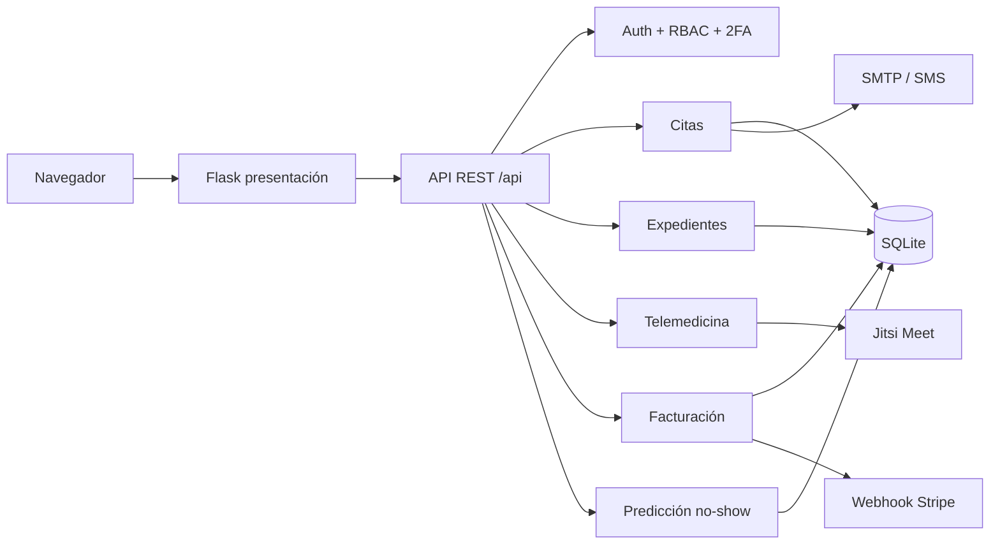
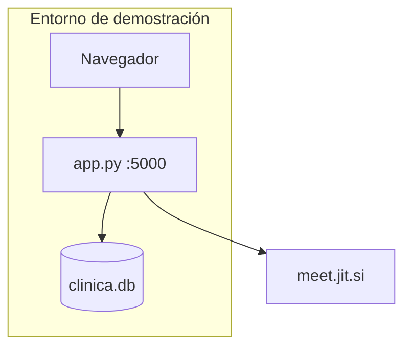
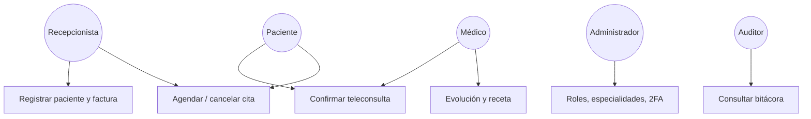
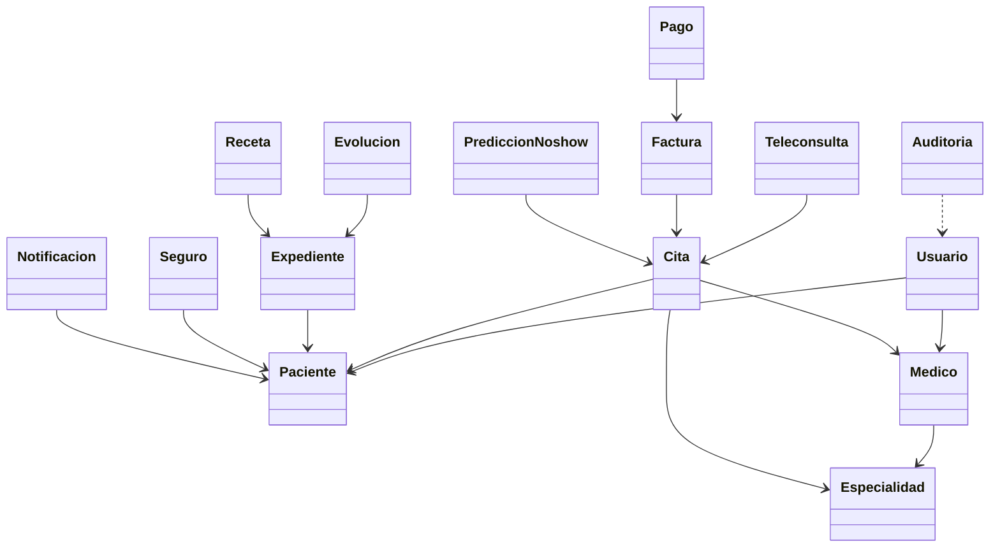
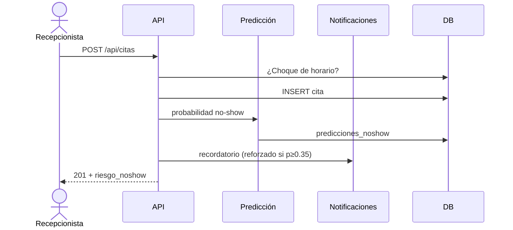
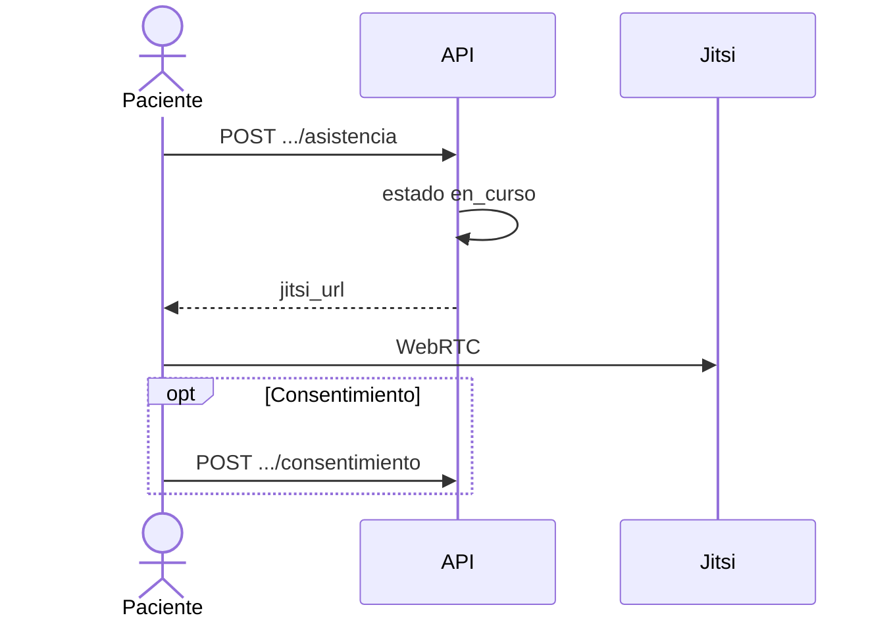
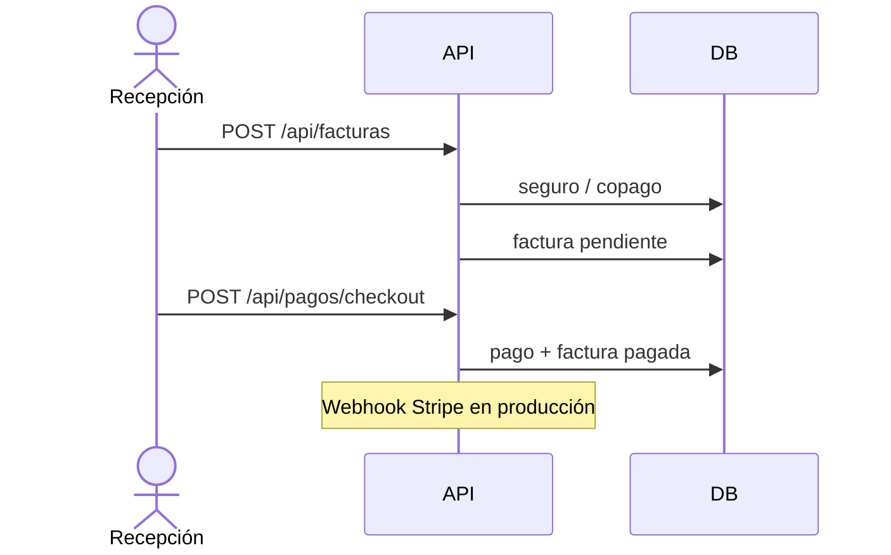

# Documento técnico — Sistema de Gestión de Citas Médicas
## Clínica San José

### 1. Introducción

La Clínica San José administra citas en papel, con choques de horario, pérdida de información y expedientes extraviados. Este documento describe un sistema web integral para pacientes, médicos, citas, expediente clínico, facturación, telemedicina, notificaciones, auditoría y analítica, incluyendo predicción de inasistencias.

El prototipo funcional corre en Flask + SQLite para demostración local. El diseño está pensado para migrar a PostgreSQL y, si el volumen lo exige, extraer servicios (notificaciones, pagos, video) como microservicios.

### 2. Objetivos

- Eliminar conflictos de agenda con validación de horario por médico.
- Sustituir el expediente físico por uno electrónico auditado.
- Ofrecer teleconsulta con sala de espera y consentimiento de grabación.
- Cobrar consultas (efectivo, seguro/copago o pasarela).
- Anticipar no-shows y reforzar recordatorios.
- Cumplir un modelo de seguridad RBAC + 2FA + bitácora inmutable.

### 3. Alcance

**Incluido en el prototipo:** usuarios y roles (admin, médico, recepcionista, paciente, auditor), especialidades, citas presenciales y telemedicina (Jitsi), expediente y evoluciones, recetas PDF, notificaciones registradas (SMTP/SMS opcionales), 2FA TOTP/correo/SMS demo, facturas y checkout simulado compatible con webhook Stripe, dashboard con barras/líneas/torta y export PDF/CSV, API REST + Swagger, modelo logístico de inasistencia.

**Fuera de alcance de producción inmediata:** receta firmada con certificado oficial, HIS/HL7, facturación tributaria electrónica nacional, grabación real de video (se registra el consentimiento; Jitsi público no garantiza archivo legal).

### 4. Justificación de arquitectura y stack

| Decisión | Justificación |
|---|---|
| Monolito modular en capas | El volumen de una clínica media no justifica microservicios de inicio; se separan presentación (plantillas/JS), negocio (blueprints) y datos (`database.py`). |
| Flask + sesiones | Entrega rápida del prototipo con RBAC en servidor. Producción: FastAPI + JWT + PostgreSQL. |
| SQLite | Cero instalación para demo. Esquema con FKs e índices migrable. |
| Jitsi Meet embebido | Videollamada WebRTC sin API key; alternativa Twilio si se requiere SLA. |
| Pasarela simulada + webhook Stripe | Permite demostrar el flujo de pago sin secretos reales. |
| Regresión logística propia | Sin sklearn: entrenable con el historial local, interpretable para el curso. |
| Auditoría con hash encadenado | Inmutabilidad demostrable (triggers SQLite + SHA-256). |

**Stack concreto**

- Backend: Python 3.10+, Flask, Werkzeug (hash de contraseñas)
- Frontend: HTML/CSS/JS, Chart.js (no es SPA completa; la API sí está desacoplada para un futuro React)
- Base de datos: SQLite (producción: PostgreSQL)
- Video: Jitsi Meet (WebRTC)
- IA: regresión logística (gradiente descendente)
- Notificaciones: tabla + SMTP (`SMTP_HOST`) / Twilio opcional
- Pagos: checkout simulado; `POST /api/payments/stripe/webhook`

No se adoptan microservicios ahora: el acoplamiento de cita–expediente–factura es transaccional. Si el alcance crece, el primer candidato a extraer es notificaciones y el segundo, video.

### 5. Modelo de capas

```
Presentación     templates/, static/js
Rutas HTTP       clinic_app/routes/
Servicios        clinic_app/services/
Acceso a datos   clinic_app/infrastructure/database.py
```

### 6. Diagrama de componentes



### 7. Despliegue



Producción recomendada: Nginx TLS → Gunicorn/Uvicorn → PostgreSQL; secretos en variables de entorno; copias cifradas; 2FA obligatorio para personal clínico.

### 8. Casos de uso (UML)



### 9. Diagrama de clases (simplificado)



### 10. Secuencia — Agendar cita



### 11. Secuencia — Teleconsulta



### 12. Secuencia — Facturación



### 13. MER (entidades)

- especialidades, medicos, pacientes, usuarios (roles + 2FA)
- citas (modalidad, riesgo_noshow)
- expedientes, evoluciones, recetas
- teleconsultas (sala, asistencia, consentimiento, grabación)
- facturas, pagos, seguros
- notificaciones, auditoria (hash_prev, hash), codigos_2fa
- predicciones_noshow

Relaciones: paciente 1—1 expediente; cita N—1 médico/paciente/especialidad; factura N—1 cita; teleconsulta 1—1 cita.

### 14. RBAC (extracto)

| Permiso | admin | médico | recepción | paciente | auditor |
|---|---|---|---|---|---|
| citas.crear | sí | | sí | propias | |
| expediente.ver | sí | sí | sí | propio | sí |
| recetas.crear | sí | sí | | | |
| auditoria.ver | sí | | | | sí |
| facturacion.crear | sí | | sí | checkout | |

### 15. Riesgos y cumplimiento (datos de salud)

- **Marco:** Ley 8968 (Costa Rica, protección de datos), deber de confidencialidad médica, y principios equivalentes a HIPAA/RGPD si hay pacientes UE/EE.UU.
- **Riesgos:** SQLite local sin cifrado en reposo; SECRET_KEY de desarrollo; Jitsi público (metadatos en tercero); SMTP en claro si no hay TLS; reidentificación en reportes.
- **Controles:** HTTPS, cookies HttpOnly, hash de contraseñas, 2FA, mínimo privilegio, auditoría de acceso a expediente, consentimiento informado para grabación, retención limitada, contrato de encargado con Stripe/Twilio/Jitsi, copias cifradas, no usar datos reales de pacientes en demo.
- **IA:** la predicción no niega la cita; solo refuerza el recordatorio. Debe informarse al paciente.

### 16. Cómo ejecutar

Ver `MANUAL_TECNICO.md`. Swagger: `http://127.0.0.1:5000/api/docs`.
